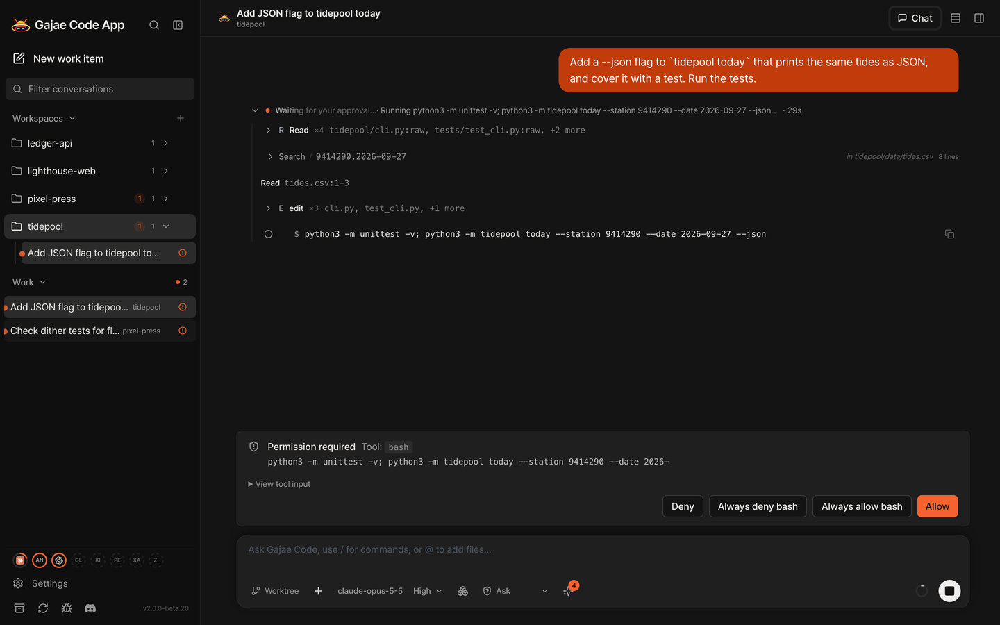

<p align="center">
  
</p>

<h1 align="center">Gajae Code App</h1>

<p align="center">
  <strong>Run the agent. Watch the work. Keep everything on your machine.</strong>
</p>

<p align="center">
  <a href="https://github.com/websterwh/gajae-code-app/actions/workflows/ci.yml"></a>
  <a href="LICENSE"></a>
  <a href="https://github.com/websterwh/gajae-code-app/pkgs/container/gajae-app-docker"></a>
  <a href="#quick-start"></a>
  <a href="https://github.com/devswha/gajae-code"></a>
</p>

<p align="center">
  <a href="https://github.com/websterwh/gajae-code-app/pkgs/container/gajae-app-docker"><b>Pull the image</b></a> ·
  <a href="deploy/docker/README.md"><b>Deployment guide</b></a> ·
  <a href="https://devswha.github.io/gajae-code-app/"><b>Website</b></a>
</p>

<p align="center">
  
</p>

<p align="center"><em>A real session: the turn's reads, search and edits folded into one work block, paused on a permission card before it runs the tests.</em></p>


Gajae Code App is a self-hosted web interface for [Gajae Code](https://github.com/devswha/gajae-code), distributed as a Docker image. It drives the agent through the runtime's own SDK in an isolated worker, shows every turn as it happens, and puts a review loop between the agent's edits and your next message — on a machine you control, with credentials that never leave it.

- **The same agent as the terminal**: the app uses the runtime's own account selection (`gjc accounts pin`, usage-limit rotation), the user's models, presets, skills, user- and project-scope MCP servers, extensions and tool settings from `~/.gjc`, and slash commands such as `/fast`, `/effort`, `/context` and `/compact`, which run as soon as you send them. Sessions open in any directory, as `gjc` does. Reasoning streams live while the model thinks.
- **Sessions with a state** — running, waiting for your answer, finished unread, or failed; a Work section lists what needs a look across every project, and the model titles each session from its first message.
- **The work, folded** — a turn's tool calls collapse into one block with a live status row; three output densities; Stop or Esc ends a turn, a message sent mid-turn steers it.
- **Permissions like the CLI** — tools run without asking by default, as in `gjc`; a project that wants cards picks Ask or Auto-approve edits, plus an always-allow list.
- **Isolated by default**: a new repository session runs in its own managed git worktree. The run-location picker can put it on the shared checkout instead.
- **A Changes tab, not a git GUI** — the working tree as a diff, a Last-turn scope for what the session just edited, and line comments that become the next message. Git stays the agent's job.
- **The tools you bring**: the container provisions APT, Python and Node packages, GitHub-release binaries, and Android `adb` access on boot, so the agent can reach a toolchain the base image does not carry.
- **Every viewer** — a second tab or a phone on the LAN sees the same live run; the layout goes down to a phone screen, and over https a phone can subscribe to push notifications for approvals and finished runs.

## Quick Start

**Docker (the published build).** `ghcr.io/websterwh/gajae-app-docker:latest` is rebuilt from `main` on every change. It carries the server, the pinned Bun runtime and the GJC SDK.

```bash
git clone https://github.com/websterwh/gajae-code-app.git
cd gajae-code-app/deploy/docker
cp .env.example .env                 # ports, packages and SSH, all optional
docker compose up -d --build
```

Open **`http://localhost:3001`**. Three volumes keep the state that matters: `./data` (database, transcripts, caches, host SSH keys), `./workspace` (the projects the agent reads and edits) and `./gjc-config` (agent configuration and credentials). After a source change, `docker compose build --pull --no-cache && docker compose up -d` picks it up.

Set `SSH_ENABLE=true` to get a shell in the same workspace — `ssh -p 2222 root@localhost`, landing in `/workspace`, or straight in a `gjc` session with `SSH_DEFAULT_COMMAND`.

Every variable, volume and provisioning option: [deploy/docker/README.md](deploy/docker/README.md).

**From source — Node.js 22.x (22.22.2+), Rust, Bun 1.4.0.** The image is the supported way to run this; a checkout is for working on it.

```bash
git clone https://github.com/websterwh/gajae-code-app.git
cd gajae-code-app
npm ci
node scripts/fetch-bun.mjs          # the pinned Bun the GJC worker runs on
npm run dev                         # server :3001, client :5173
```

The checkout still carries the Tauri desktop shell in `src-tauri`, but no desktop installer is built or published: the deployment target is the container, and the macOS and Linux desktop lanes (`.github/workflows/desktop-macos.yml`, `desktop-linux.yml`) run only when dispatched by hand.

## Permission Modes

The runtime's own gate defaults to *allow*, and so does the app: a project starts on **Bypass**, exactly like a `gjc` session in the terminal. Every project has a persisted mode, set from the composer or Settings → Permissions, and an always-allow list that the permission card's **Always allow** fills.

| Mode | Runs without asking | Waits for approval |
|---|---|---|
| **Ask** | Reads, searches, and file writes and edits the runtime does not gate | Commands (`bash`, `eval`), file deletes and moves — everything the runtime gates |
| **Auto-approve edits** | The above, plus every file mutation (`edit`, `write`, `delete`, `move`) | Commands |
| **Bypass** (default) | Everything, as in the GJC CLI | Nothing |

A card answered in one tab closes in every other viewer. Always deny is offered when the runtime offers it and holds for the run.

## Facts

|  |  |
|---|---|
| **Runtime** | Gajae Code SDK 0.20.0 on Bun 1.4.0, bundled in the image, driven in an isolated worker; prompts pass through an owner-readable temp file, never a process argument |
| **Where things live** | In the container: `/data` (database, transcripts, caches, SSH keys), `/workspace` (projects), `/root/.gjc` (credentials and skills) — all three on volumes. From a checkout: `~/.gajae-app`, with transcripts in the runtime's own session files, never copied into the app's database |
| **Network** | Loopback by default and fail-closed (it can run shell commands); cross-origin callers are rejected on HTTP and WebSocket |
| **Trust boundary** | One owner: whoever reaches the server is the owner, so the network is the boundary — loopback, a tailnet, or a proxy that authenticates in front. Managed worktrees run git without the system or user gitconfig; a checkout filter in a repository's own `.git/config` (git-lfs is one) still runs, the same trust `git status` places in a checkout you opened |
| **Stack** | React 19 · Vite 7 · Tailwind 4 · Express · SQLite · a Rust core · Docker for deployment |
| **Gate** | `npm run verify`: audit, typecheck, Rust core, tests, GJC e2e, lint, identity check, build |
| **License** | MIT since v2.0.0-beta.7 (earlier betas AGPL-3.0) |

## Documentation

- [Docker deployment, environment and volumes](deploy/docker/README.md) · [Self-hosting](docs/SELF-HOST.md) · [Install the server archive](docs/INSTALL.md)
- [Changelog](CHANGELOG.md) · [Design system](DESIGN.md) · [Repository guide for agents](AGENTS.md)
- [Built-in browser contract](docs/BUILTIN-BROWSER.md)
- [GJC provider and worker contract](server/GJC-LIVE-SPEC.md) · [Worker protocol](docs/GJC-WORKER-PROTOCOL.md)
- [Licensing](docs/LICENSING.md) · [Relicensing record](docs/RELICENSING.md) · [Upstream intake](docs/UPSTREAM.md)
- [Contributing](CONTRIBUTING.md) · [Contributor terms](CLA.md)

## License

MIT. See [LICENSE](LICENSE) and [THIRD-PARTY-NOTICES.md](THIRD-PARTY-NOTICES.md). The project began as a fork and was rewritten file by file before relicensing; [docs/UPSTREAM.md](docs/UPSTREAM.md) names the origin and [docs/RELICENSING.md](docs/RELICENSING.md) records the method and the measured residual.
